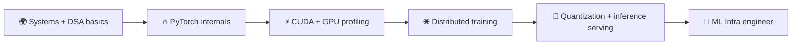

<div align="center">


<a href="https://git.io/typing-svg"></a>

<br/>


[](https://linkedin.com/in/YOUR_LINKEDIN)
[](mailto:YOUR_EMAIL)

</div>

---

## 🛸 Mission Control

<div align="center">

| [👨‍🚀 Crew Manifest](#-crew-manifest) | [🧰 Flight Deck](#-flight-deck) | [🚀 Payloads](#-payloads) | [📡 Telemetry](#-telemetry) | [🗺️ Roadmap](#%EF%B8%8F-roadmap) | [📨 Comms](#-comms) |
|:--:|:--:|:--:|:--:|:--:|:--:|

</div>

> 💡 **Tip:** Every section below is a collapsible panel. Click the ▶ to open it.

---

## 👨‍🚀 Crew Manifest

<details open>
<summary><b>▶ Pilot profile</b></summary>
<br/>

```text
> NAME        : Kuresh
> RANK        : B.Tech CSE, 3rd year @ Manipal University Jaipur
> SPECIALTY   : ML Infrastructure
> ORBIT       : distributed training · GPU optimization · inference serving · quantization
> TARGET      : top-tier tech placements
> SIDE QUESTS : document & certificate generation
> STATUS      : 🟢 online
```

</details>

<details>
<summary><b>▶ Current mission objectives</b></summary>
<br/>

- 🔭 Going deep on **distributed training** (data / tensor / pipeline parallelism)
- ⚡ Learning **GPU optimization**: CUDA, memory hierarchy, kernel profiling
- 🧠 Exploring **inference serving** and **quantization** for cheaper, faster models
- 🎯 Sharpening DSA and systems fundamentals for placements

</details>

<details>
<summary><b>▶ Fun facts (classified)</b></summary>
<br/>

- 🏋️ Fuels the codebase with consistent gym sessions
- 🌌 Believes the best bug is the one caught before launch
- ☕ Replace with your own fact here

</details>

---

## 🧰 Flight Deck

<details open>
<summary><b>▶ Tech stack</b></summary>
<br/>

<div align="center">


</div>

| System | Tools |
|:--|:--|
| 🧮 **Languages** | Python, C++, C, Bash |
| 🤖 **ML / Infra** | PyTorch, CUDA, NCCL, Triton, vLLM |
| ☁️ **Ops** | Docker, Kubernetes, Linux, Git |

> Edit this table to match what you've actually shipped. Honest > impressive.

</details>

<details>
<summary><b>▶ Mission skill levels</b></summary>
<br/>

```text
Python           ████████████████░░░░  80%
C++              ████████████░░░░░░░░  60%
PyTorch          ██████████████░░░░░░  70%
CUDA             ██████░░░░░░░░░░░░░░  30%   ← climbing
Distributed ML   ███████░░░░░░░░░░░░░  35%   ← climbing
```

*Adjust the bars to your real levels.*

</details>

---

## 🚀 Payloads

<details open>
<summary><b>▶ Featured launches</b></summary>
<br/>

<div align="center">

<a href="https://github.com/YOUR_USERNAME/sentinel-commerce">
  
</a>
<a href="https://github.com/YOUR_USERNAME/YOUR_REPO">
  
</a>

</div>

| Mission | What it does | Stack |
|:--|:--|:--|
| 🛡️ **Sentinel Commerce** | Merchant-side AI growth agent for failed-payment recovery, gated by a safety architecture (Razorpay Buildathon) | Python, LLMs |
| 🛰️ **Your next project** | One-line description | Stack |

</details>

---

## 📡 Telemetry

<details open>
<summary><b>▶ Live GitHub stats</b></summary>
<br/>

<div align="center">


</div>

</details>

<details>
<summary><b>▶ Contribution graph</b></summary>
<br/>

<div align="center">


</div>

</details>

<details>
<summary><b>▶ 🐍 Snake eating my contributions</b></summary>
<br/>

<div align="center">

<picture>
  <source media="(prefers-color-scheme: dark)" srcset="https://raw.githubusercontent.com/YOUR_USERNAME/YOUR_USERNAME/output/snake-dark.svg"/>
  
</picture>

</div>

</details>

<details>
<summary><b>▶ 🏆 Trophy cabinet</b></summary>
<br/>

<div align="center">


</div>

</details>

---

## 🗺️ Roadmap

<details>
<summary><b>▶ Flight plan: ML Infrastructure</b></summary>
<br/>



- [x] Core CS fundamentals
- [ ] PyTorch internals and autograd
- [ ] CUDA kernels + profiling
- [ ] Multi-GPU training from scratch (DDP → FSDP)
- [ ] Inference serving and quantization project
- [ ] Land the launch 🚀

*Tick the boxes as you go.*

</details>

---

## 📨 Comms

<div align="center">

**Got a mission? Open a channel.**

[](https://linkedin.com/in/YOUR_LINKEDIN)
[](mailto:YOUR_EMAIL)
[](https://x.com/YOUR_HANDLE)


</div>
